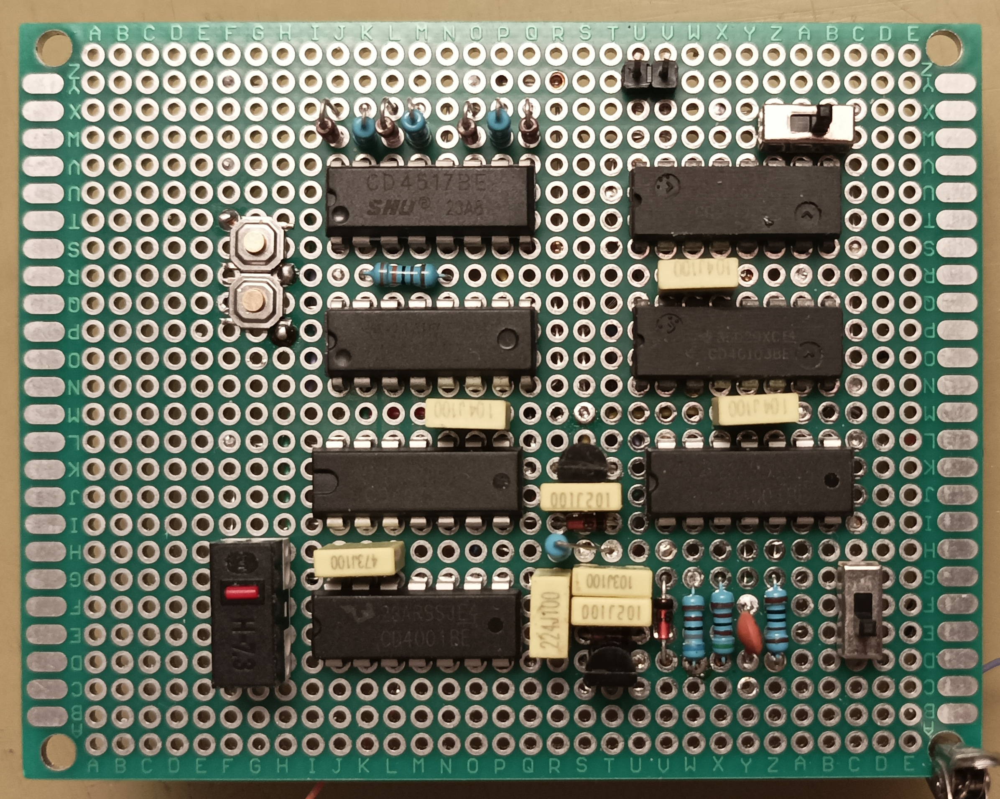
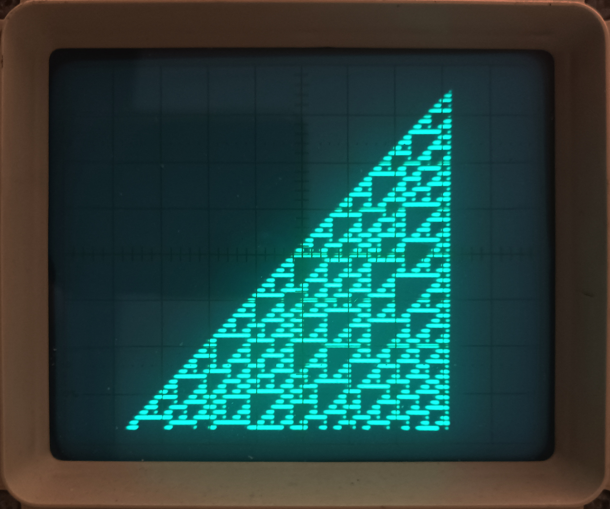

# «Правило 110» на микросхемах мелкой логики

[English](README.md) | Русский

Статьи на Хабре: [1](https://habr.com/ru/articles/1105190), [2](https://habr.com/ru/articles/1105450/), [3]()

Этот проект — реализация клеточного автомата "Правило 110" на микросхемах мелкой логики 4000-й серии.

Он обрабатывает клетки последовательно, что позволяет сильно сократить требуемое количество микросхем.

Последовательная обработка требует и последовательного вывода: в этом проекте изображение развития клеточного автомата выводится на экран аналогового осциллографа.

Публикуется под лицензией MIT. Её действие распространяется на схемы, документацию и скрипты.
